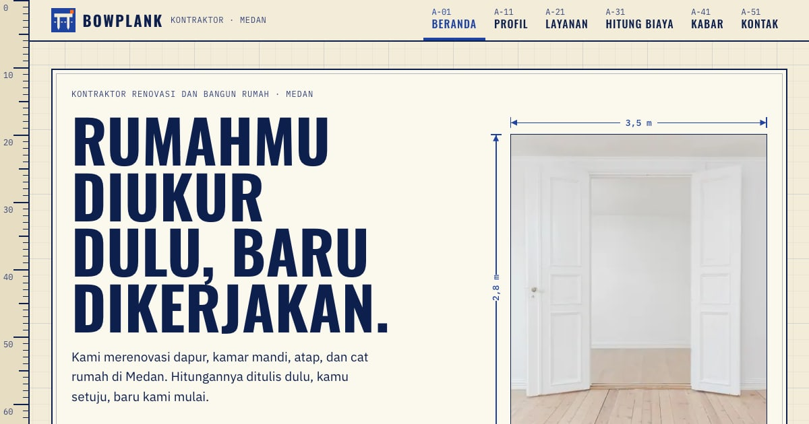

# Bowplank — Kontraktor renovasi dan bangun rumah di Medan

Situs company profile demo untuk paket **Standar UMKM** PintuWeb. Bowplank adalah kontraktor renovasi dan bangun rumah fiktif dari Medan. Namanya dari *bouwplank*, papan patok yang dipasang di tanah untuk menandai letak bangunan sebelum tembok pertama berdiri. Ciri khasnya: rumah diukur dulu, hitungan ditulis dulu, baru dikerjakan.

**Demo live:** https://profil-kontraktor.pintuweb.id



> Bowplank adalah usaha fiktif. Nama, alamat, jam kerja, layanan, lama kerja, proyek contoh, tulisan, dan tarif per m² semuanya rekaan; tarifnya hanya contoh, bukan harga pasar atau penawaran. Tidak ada nomor telepon, email, ulasan, atau pelanggan sungguhan. Tidak ada data yang dikirim ke server: formulir kontak dan tombol hitung hanya menyusun pesan WhatsApp tanpa nomor tujuan.

## Yang diperlihatkan

Lima halaman isi paket Standar UMKM, ditambah satu halaman khas:

- **Beranda** (`/`): lembar pembuka dengan foto yang diberi garis ukuran, daftar pekerjaan berfoto, urutan kerja sebagai rantai ukuran A sampai D, perbandingan sebelum-sesudah yang bisa digeser, ajakan ke alat hitung, kabar terbaru, dan kontak.
- **Profil** (`/profil`): asal nama (gambar bouwplank dan empat bagiannya), empat catatan kerja, empat tokoh lapangan (ilustrasi tanpa wajah), dan foto alat.
- **Layanan** (`/layanan`): lima pekerjaan (renovasi dapur, kamar mandi, atap dan plafon, cat ulang, tambah kamar atau lantai). Tiap pekerjaan memuat yang dikerjakan, lama kerja contoh, dan yang perlu disiapkan pemilik rumah. Di bawahnya ada tiga proyek contoh dengan gambar garis sebelum-sesudah buatan sendiri.
- **Kabar** (`/kabar`, `/kabar/<slug>`): tiga tulisan contoh (tanda atap perlu diperiksa, urutan kerja kamar mandi, cara membaca hitungan biaya).
- **Kontak** (`/kontak`): formulir yang menyusun pesan WhatsApp, jam kerja, alamat contoh, dan peta ilustrasi.
- **Hitung biaya** (`/hitung-biaya`, halaman khas): geser luas ruangan (4 sampai 40 m²), pilih pekerjaan (cat ulang, ganti keramik, plafon, atap), dan kelas bahan (hemat, menengah, bagus). Hasilnya rentang biaya dan lama kerja contoh beserta rincian per pekerjaan, denah yang ikut berubah, dan tombol kirim hitungan ke WhatsApp. Label "Contoh perhitungan, bukan penawaran harga" selalu tampak di dekat angka; tabel tarif berlabel "Contoh harga, bukan harga pasar".

Data terstruktur `GeneralContractor` (tanpa telepon, tanpa rating), `BreadcrumbList` di halaman dalam, dan `BlogPosting` di tulisan kabar.

## Identitas visual

- **Huruf:** Oswald huruf kapital (judul), IBM Plex Sans (teks), IBM Plex Mono (ukuran, nomor lembar, label). Semua lewat `next/font`, variabel dipasang di `<html>`.
- **Warna:** krem kertas gambar, biru cetak-biru sebagai satu-satunya warna dominan, tinta biru tua untuk teks. Oranye pelampung hanya titik kecil (penanda titik ukur, gagang penggeser, bayangan tombol di lembar biru).
- **Motif:** kertas gambar teknik dengan kisi cetak-biru, panah ukuran ("3,5 m") di foto dan gambar, penggaris tegak di tepi kiri yang ikut bergulir (hiasan, `aria-hidden`), dan bento berupa lembar gambar bernomor (A-01, A-02, ...) dengan kepala gambar (title block). Lembar biru memakai kisi putih seperti cetak biru asli.
- **Ilustrasi:** logo, bouwplank, empat tokoh lapangan tanpa wajah, gambar garis sebelum-sesudah, peta, dan denah digambar sendiri sebagai SVG di `components/Gambar.js`.

## Model data

- `lib/data.js`: identitas usaha (`site`), navigasi enam halaman, lima layanan, tiga proyek contoh, urutan kerja, catatan kerja, orang di lapangan, foto alat, dan `pesanWa()` (tautan `wa.me` tanpa nomor).
- `lib/kabar.js`: tulisan contoh sebagai blok (`p`, `h2`, `ul`, `ol`, `catatan`), menit baca, dan tanggal.
- `lib/biaya.js`: tarif per m² untuk tiap pekerjaan dan kelas bahan, asumsi hitungan (perbandingan sisi 4 : 3, tinggi dinding 3 m, pengurang pintu dan jendela, faktor atap), `hitung()` untuk rentang biaya dan lama kerja.
- `lib/seo.js`: metadata Open Graph per halaman dan JSON-LD.

## Teknologi

- Next.js 15.5 (App Router) dan React 19, JavaScript
- Tailwind CSS v4 (`@theme static` di `app/globals.css`)
- Gambar statis tanpa Image Optimization Vercel: varian WebP di `public/_img/` lewat `image-loader.js`. Setelah menambah atau mengganti foto di `public/images`: `node scripts/static-images.mjs . --dirs public/images`

## Menjalankan secara lokal

```bash
npm install
npm run dev
```

Build produksi: `npm run build` lalu `npm start`. Pemeriksaan kode: `npm run lint`.

## Kredit gambar

Foto berlisensi CC0 1.0 atau domain publik dari Wikimedia Commons, semuanya hanya ilustrasi. Daftar lengkap dan ilustrasi buatan sendiri ada di [`public/images/SUMBER.md`](public/images/SUMBER.md).

---

Dibuat oleh [PintuWeb](https://www.pintuweb.id), jasa pembuatan website.
